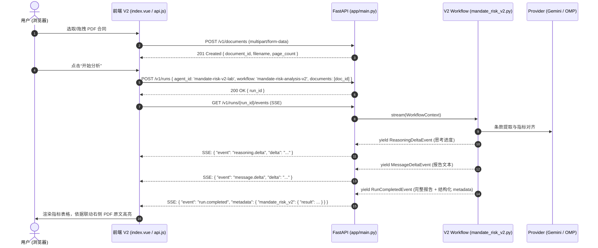

# 友邦 Mandate 投资委托风险指标分析系统 (V2) 架构与联调指南

本文档汇总了 **友邦投资委托（Mandate）风险指标智能拆解系统 V2** 的前后端工程架构、业务数据链路、接口契约及本地开发联调方式。

---

## 一、系统整体定位与技术架构

系统核心目标：通过大模型与权威风险指标库（Markdown 权威源 `指标知识库.md` 及其预编译产物 `指标知识库.generated.json`）对齐，自动解析用户上传的投资委托合同（PDF），提取条款、评估指标匹配度并给出原文依据，在前端以结构化交互表格呈现。

### 技术栈一览

| 模块 | 前端工程 (`datadriver-fund-amc-tyjx-vue`) | 后端工程 (`vmchat-hermes-replacement-python`) |
| :--- | :--- | :--- |
| **基础框架** | Vue 2.5.17 + Element-UI 2.12.0 + Webpack | FastAPI + LangGraph + Uvicorn + Pydantic V2 |
| **工程路径** | `/Volumes/onePiece/公司前端项目/友邦绩效/datadriver-fund-amc-tyjx-vue` | `/Volumes/onePiece/公司前端项目/AI项目/vmchat-hermes-replacement-python` |
| **运行环境** | Node.js `v14.19.0` (构建与预览) | Python `3.10+` (uv 虚拟环境) |
| **服务端口** | 主系统 `9528` / 独立预览 `19529` | 本地服务 `8002` (备用 `8000`) |
| **通信协议** | HTTP REST + **SSE (Server-Sent Events) 流式传输** | 同左 |
| **模型后端** | 通过 Webpack 代理 `/mandate-api` 访问后端 | Google Gemini (`gemini-3.8-flash` / `gemini-3.5-flash-lite`) |

---

## 二、前端工程架构 (`src/views/mandateRiskV2/`)

前端 V2 模块采用独立轻量设计，既可以在企业主系统路由中运行，也可在独立预览服务中免登录快速联调：

### 1. 目录结构
```
src/views/mandateRiskV2/
├── index.vue                # 三栏布局：左侧对话与附件输入、中间结果、右侧 PDF 原文
├── api.js                   # API 契约封装：文档上传、创建 Run、SSE 流式 Reader 解析
├── session.js               # 会话状态机：upload -> create-run -> streaming -> completed / error
├── report.js                # 数据解析器：Markdown 降级提取、metadata.result 结构化提取、多维过滤与合并单元格
├── pdfEvidence.js           # 原文规范化匹配、重复匹配拒绝与 DOM 字符范围映射
├── samples.json             # 固收/权益历史回放样例数据（免接口直接查看）
├── components/
│   ├── RiskResult.vue       # 分组表格、匹配分筛选、多选与查看依据事件
│   ├── PdfViewer.vue        # PDF.js 当前页预览、翻页/缩放与黄色原文高亮
│   └── SafeMarkdown.vue     # 安全 Markdown 渲染组件：showdown + 严格标签与属性白名单防 XSS
├── preview/                 # 独立开发环境（脱离主工程 CAS 登录与多余路由）
│   ├── index.html
│   ├── entry.js
│   └── webpack.config.js    # 独立端口 19529，直连 /mandate-api 代理
└── tests/                   # 独立单元与仿真测试
    ├── module.test.cjs      # 核心逻辑单测（契约、SSE、防注入、表格跨度）
    └── mock-backend.cjs     # 本地测试用的 Mock SSE 服务
```

### 2. 页面访问与独立预览
- **业务系统内嵌路由**：`http://localhost:9528/#/mandate-risk-v2`（沿用原有系统 CAS/SSO 登录控制）
- **独立免登录预览**：`http://127.0.0.1:19529/`
  ```sh
  cd /Volumes/onePiece/公司前端项目/友邦绩效/datadriver-fund-amc-tyjx-vue
  BABEL_ENV=development MANDATE_API_URL=http://127.0.0.1:8002 /Users/liuruibing/.nvm/v14.19.0/bin/node node_modules/webpack-dev-server/bin/webpack-dev-server.js --config src/views/mandateRiskV2/preview/webpack.config.js
  ```

### 3. 核心交互机制
- **状态流转**：`idle` → `uploading` → `ready` → `creating-run` → `streaming` → `completed` / `error`。
- **对话与 PDF 联动**：附件在左侧输入框暂存，发送后才上传并启动分析；不展示文档卡片或分析流程面板。中间保留搜索、评分筛选和勾选。点击“查看依据”按 `mapping_evidence` 的物理页码与原文联动右侧 PDF.js 预览，支持多条引用切换、缩放和黄色高亮。匹配缺失或存在歧义时提示，不误标。预览使用本次上传的 File，刷新后需要重新上传；详情保留算法和人工确认项。

---

## 三、后端工程架构与数据链路

后端核心逻辑位于 `app/workflow/graphs/mandate_risk_v2.py` 与 `app/mandate_risk_v2/`：



### 1. 核心 API 契约
- **健康检查**：`GET /health` → `{ "status": "ok", "workflows": ["mandate-risk-analysis-v2", ...] }`
- **上传文档**：`POST /v1/documents`（文件上限 20MB）→ `{ "document": { "document_id": "...", "page_count": 6 } }`
- **发起分析**：`POST /v1/runs`
  ```json
  {
    "agent_id": "mandate-risk-v2-lab",
    "role_id": "requirement-analyst",
    "workflow": "mandate-risk-analysis-v2",
    "documents": ["doc_xxx"],
    "input": [{ "role": "user", "content": "..." }],
    "session_id": "mandate_v2_xxx"
  }
  ```
- **SSE 事件流**：`GET /v1/runs/{run_id}/events`
  - `reasoning.delta`：工作流阶段进度；当前页面不单独展示推理面板
  - `message.delta`：流式报告片段
  - `run.completed`：包含 `output`（Markdown 全文）和 `metadata.mandate_risk_v2.result`（合同概览、指标列表、分值、原文依据）

### 2. 双分析模式与策略依据关联

#### (1) 双分析模式
- **Screening Mode（快速筛选，默认）**：直接比对 PDF 条款与预编译完整指标库（`指标知识库.generated.json`），输出匹配分与依据，延迟低、覆盖全。
- **Detailed Mode（深度两阶段）**：
  - **Phase A (`RequirementExtractionPipeline`)**：提取 Mandate IR 结构化需求并执行覆盖审计。
  - **Phase B (`MappingPipeline`)**：12 维度兼容性评估与 Critic 独立复核。

两种模式均返回 `result.document_profile`，包含 `asset_scope`、`instruments`、`benchmark`、`investment_strategy`；未找到有效依据的字段为 `null`。模型基于全文语义理解进行灵活性提取（不受固定章节编号、特定标题、关键字或中英文限制），输出中文简述 summary 与覆盖完整主文的 `evidence_clause_ids`。程序从当前 PDF 条款还原原文、物理页码及字符偏移，拒绝未知条款并按文档顺序去重。

#### (2) 策略依据与当前指标关联分析 (Strategy Evidence Post-Pass)
系统在快速筛选（Screening）或深度分析 Phase B（Detailed）选定当前显示指标后，发起后处理阶段（`StrategyEvidencePipeline`），阅读 PDF 全文条款与当前已选指标上下文，提取委托原文核心章节分类与投资策略要点，并评估“策略要点 → 当前指标的相关性与依据”。

- **业务定位与紧凑原文展示（下表 100% 隔离）**：
  - **上半部分核心定位**：「委托原文」左侧固定展示 Instruments、Benchmark、Investment Strategy 三个语义分类，右侧默认完整展示选中分类的真实原文及页码/查看 PDF，不截断正文，不根据 PDF 目录生成更多标签。仅保留标题处整体收起/展开，底部不再提供局部展开/收起按钮；长原文随中间内容区域滚动。AI 按当前文档语义归类，原文标题、编号、文本与证据偏移完整保留；分类缺失明确提示未识别到原文，不补写示例内容。
  - **100% 下表隔离**：动态分类切换、展开与折叠绝不重置下方指标表格的复选框、排序、评分或分组状态；**不负责 key/core/Indicator 等动态分组，绝不重新分类或重排下方表格**，下方指标表格 100% 保留现有契约、分组、评分与展示逻辑。
  - **后端保留丰富分析**：后端完整保留 `points`、`metric_links` 与 `unlinked_metrics` 丰富分析数据供审计与扩展，前端默认不展示微观卡片。
  ```json
  {
    "sections": [
      {
        "section_id": "DS-0001",
        "category": "instruments",
        "title": "8. Permitted Instruments",
        "evidence": [
          { "clause_id": "c0012", "page": 5, "text": "Listed Equity; Cash and Cash Equivalents...", "source_start": 3280, "source_end": 3390 }
        ]
      }
    ],
    "points": [
      {
        "point_id": "ST-0001",
        "title": "投资策略要点标题（中文短语）",
        "summary": "基于原文的简述说明",
        "evidence": [
          { "clause_id": "c0012", "page": 4, "text": "The Sub-Portfolio seeks to achieve...", "source_start": 3280, "source_end": 3390 }
        ],
        "metric_links": [
          {
            "raw_row_id": 2,
            "metric_name": "基金收益率",
            "basis": "EXPLICIT",
            "reason": "原文明确要求与测量目标",
            "evidence": [
              { "clause_id": "c0012", "page": 4, "text": "...", "source_start": 3280, "source_end": 3390 }
            ]
          }
        ]
      }
    ],
    "unlinked_metrics": [
      {
        "raw_row_id": 3,
        "metric_name": "久期",
        "reason": "当前条款中未找到明确策略关联"
      }
    ]
  }
  ```
- **三大核心语义业务板块 (`sections`) 规范**：
  - **三大专属业务分类 (`category`)**：仅限 `instruments`（投资标的与范围）、`benchmark`（业绩比较基准）、`investment_strategy`（投资策略与目标）。
  - **保留模型原文标题 (`title`)**：保留 PDF 实际章节标题；前端标签固定为 Instruments / Benchmark / Investment Strategy，不展示章节编号。章节编号、标题语言和文档排版不是分类的硬性条件。
  - **提示词引导过滤非业务样板**：排除独立词汇定义、行政程序、限制条款与风险政策的全量搬运。具体数值限额仍由下方 points / metric_links 精准引用；基准名称、代码和比例只取自当前文档，不在提示词中预填样例指数。
  - **真实缺失原则**：文档未包含的分类真实留空（不伪造假章节或假条款），前端以未识别到条款真实展示。
  - **稳定 Python 标识与物理排序**：跨窗口统一按类别合并（每个分类最多一个 section），内部条款严格去重并按 `source_start` 物理顺序排序；分类按固定语义顺序输出（`instruments` → `benchmark` → `investment_strategy`），分配稳定 ID（`DS-0001`, `DS-0002`...）。
- **关联依据分类 (`basis`)**：
  - `EXPLICIT` (原文明示)：仅当原文明确指出或指定该具体测量概念/指标时标注（例如同时包含跟踪误差策略与定量限额条款）。不能仅因跟踪误差存在或泛泛的资本增值描述而将信息比率误标为明示。
  - `INFERRED` (策略推导)：由原文的主动管理、超额收益或目标策略推导出的合理监控用途（例如由主动超额收益策略推导信息比率监控）。
  - `UNCERTAIN` (待核实)：依据较弱或存在潜在不确定性的关联。
- **校验与覆盖规则**：
  - **权威字段 Python 主导**：`section_id`、`point_id` 与 `metric_name`（权威 `MetricReference` 名称）由 Python 权威写入，模型仅输出 `raw_row_id` 与源 `evidence_clause_ids`。
  - **全覆盖与互斥处置**：给出的每一个当前选定指标在每个窗口中必须恰好被处置一次（关联至 `metric_links` 或归入 `unlinked_metrics`），禁止同一窗口内既关联又归入未关联。
  - **允许零关联不强配**：真实策略要点与原文章节均允许不关联指标，绝不上捏造虚假指标关联。
  - **跨窗口关联优先**：长文档多窗口处理时，后续窗口提取到的有效 link 优先覆盖先前窗口的未关联处置。全局 `unlinked_metrics` 仅包含在所有窗口中均未建立任何关联的指标。
  - **严格原文引用校验**：章节、要点与关联的 `evidence_clause_ids` 必须非空且全为真实条款 ID；未知或空引用触发结构化校验重试/失败。
- **阶段进度、独立用量与异常隔离**：
  - Screening: `Sequence 1 (快速筛选)` → `Sequence 2 (筛选完成，开始策略依据关联)` → `Sequence 3 (策略依据与指标关联完成)`
  - Detailed: `Sequence 1 (Phase A)` → `Sequence 2 (Phase A 完成)` → `Sequence 3 (Phase B 完成，开始策略依据关联)` → `Sequence 4 (策略依据与指标关联完成)`
  - `usage` 中包含 `strategy_evidence_phase` 独立用量字典；仅在所有阶段均完整完成时才输出顶层 `total_tokens`。
  - 策略依据分析失败抛出独立的 `V2 策略依据与指标关联分析失败` 事件，不混淆为筛选或映射失败。历史分析结果 `strategy_evidence` 若缺少 `sections`，前端提示需重新发起分析并提供回退说明。
- **当前真实 OMP / Gemini 三块原文验收** (`run-7ad71945-c596-491a-8e46-7311af942860`)：
  - 真实 7 页 `权益sample.pdf`：上传 201、创建任务 200、SSE 200，SSE 耗时 57.72 秒，识别 22 个指标。
  - AI 提取三类共 16 处原文引用：Instruments 为上市权益及不超过一年的现金/现金等价物；Benchmark 为原文 MSCI China A International High Dividend Yield Index Total Return (CNY)，代码 MS714721；Investment Strategy 合并第 4、5 页投资目标与策略。引用文本、页码和字符起止位置与独立解析的 136 条款逐项一致。
  - 三标签切换与顶部整体收起/展开后，22 个指标及匹配分与同一运行结构化结果逐行一致，基金收益率勾选保留。基金收益率的三个真实参考组合、超额收益率与 Alpha 的有效配置匹配保持正确。
  - 查看 Benchmark 原文定位第 5 页，13 个黄色高亮矩形；下方跟踪误差“查看依据”仍定位第 4 页，19 个高亮矩形，自动收起左侧对话。
  - 1568px 桌面及 1100px PDF 展开视口无根页面横向溢出；Console Error、Page Error、失败网络请求及接口错误均为 0。证据位于前端 `design-plans/mandate-three-blocks.validation.json` 及对应桌面、PDF 窄屏截图。
  - 回归：后端全量 346 项通过；最终提示词调整后策略依据行为测试 19 项通过；前端模块回归及变更文件 ESLint 通过；内置发布笔记本 4 个代码单元与嵌入模块通过语法校验。
  - 最新全文默认展示调整使用此真实运行结果回放验证，未重复调用模型：三分类正文完整显示且无行数截断，底部仅保留“查看PDF”；顶部整体收起/展开和表格滚动正常，22 个指标及勾选保留。1100px PDF 展开视口下基准全文可读，第 5 页保持 13 个黄色高亮矩形；最新前端模块回归及组件 ESLint 通过。
- **历史验证记录（前序侧边栏动态原文版，已由三块原文取代）** (`run-46a5a97a-ea92-46f9-9cdf-7cc144a570bc`)：
  - 输入：真实 7 页 `权益sample.pdf`（14,350 字符，136 条款）
  - 耗时与流式：SSE 总耗时 65.38 秒；真实浏览器端实际网络 Upload 201、run 200、SSE 200，无 Console / Page Error。
  - 动态分类与原文引用：提取 6 个核心业务章节，全 6 章节共 57 处条款引用，引用的文本、页码与 `[source_start, source_end]` 偏移量经独立 `PdfDocumentParser` 与 `split_document_clauses` 逐字节核验 100% 完全精确一致；自动排除术语表与行政程序套话。
  - 侧边分类与编号清理：左侧自适应垂直标签页（桌面 180px 宽，最大高度 160px 纵向滚动；1100px 窄屏打开 PDF 时自动自适应收缩至 95px，下表与卡片 100% 无横向溢出）；展示标签自动清理前导与合并章节编号（如 `6. Base Currency & 7. Sub-Portfolio Benchmark Index` 净化展示为 `Base Currency & Sub-Portfolio Benchmark Index`），且严格保留 `0.5% p.a.`、`3.5 Year`、`CSI 300` 等业务数值含义；原文预览及元数据完整保留原始编号。
  - 关联结构与下表隔离：6 个章节，关联 22 个当前选定指标，全量 22 指标行、评分与多选框状态（如 TE 指标勾选态）在分类切换与展开折叠时 100% 保持不变。
  - 布局与交互验收：首屏顶部委托原文区域仅占 220px，下方指标表格在 345px 即可见（处于 884px 初始视口内）；折叠后仅 50px；查看 PDF 准确联动并渲染 71 处高亮矩形。
- **历史验证记录（前序横向标签页紧凑动态原文基线）** (`run-cb718f8e-38de-4d12-a994-cf069711e741`)：
  - 动态原文紧凑版初期验证，采用横向滚动标签页，指标表格首屏可见，57 处条款引用精确一致。
- **历史验证记录（前序卡片式关联基线，已被本期紧凑动态原文取代）** (`run-dae310da-ff12-4137-bef5-52b56d6f13f6`)：
  - 总耗时：55.52 秒
  - 关联结构：4 个策略要点，关联 21 个当前选定指标，0 个未关联指标；67 处要点与关联原文引用校验全部正确。
  - 分类对齐：TE 正确标记为 `EXPLICIT`（获 Page 5 策略与 Page 6 限额支持）；IR 正确标记为 `INFERRED`（获 Page 4 目标与 Page 5 增强策略支持）。
  - 阶段 Token 用量：`screening_phase`: 13,219 tokens，`strategy_evidence_phase`: 12,537 tokens，`total_tokens`: 25,756 tokens。
  - 各阶段均 1 次成功完成，无 retry / repair 校验重试。
- **显式编译与校验命令**：
  - 重新编译生成 JSON 产物：`python -m app.mandate_risk.catalogue`
  - 检查产物与 Markdown 编译结果一致，且不修改文件：`python -m app.mandate_risk.catalogue --check`
- **部署门禁**：部署及启动脚本 `run_start.sh` 在 uvicorn 服务启动前强制运行 `--check` 校验；校验失败终止启动。
- **归档数据说明**：`agents/mandate_risk_ai/knowledge/raw/risk_metrics.raw.csv` 与原始 Excel 工作表已归档，仅保留用于离线数据比对与历史转换验证，不作为运行时知识源。
- **更新生效流程**：修改 Markdown → 显式生成 JSON → 执行 `--check` → 重启服务。每个 Worker 内 V1/V2 共享不可变指标快照；运行中的服务不会自动刷新。
- **启动边界**：业务进程只读取 JSON，并读取 Markdown 原始字节做 SHA-256 校验，不解析 Markdown 结构。部署门禁 `--check` 是独立离线校验，会解析源文档并比较完整编译结果。
- **自定义指标库**：`MANDATE_RISK_METRIC_SOURCE` 仅接受预生成 `.json` 文件路径，产物引用的 Markdown 源文件也必须随包部署。运行时不再接受 CSV/XLSX，旧 `MANDATE_RISK_METRIC_XLSX` 配置已移除。

### 3. 参考组合（Reference Portfolios）配置与版本生效解析机制

#### (1) 真实数据源与显式映射维护
- **生产真实快照 (`参考组合.snapshot.json`)**：
  - 位于后端根目录，为离线导出的生产真实配置快照（包含 Oracle AMC_TYJX 库 `ET_PORT_KCINDEX_CONFIG`、`ET_PORT_KCINDEX_CONFIG_DETAIL`、`E_DIM_PORTAL` 的只读导出）。
  - 结构版本为 `schema_version: 1`，包含 5 条配置、15 条明细、8 条字典，无孤儿数据。
  - **零在线 DB/DBX 依赖**：运行时 100% 仅读取本地 JSON，无需连接生产数据库或 DBX MCP。
  - **手动导出与刷新机制**：若生产配置变更，离线执行只读导出并更新覆盖根目录 `参考组合.snapshot.json` 即可随仓库生效，无需重启任何外部数据库服务。
- **显式等价映射文件 (`参考组合映射.json`)**：
  - 位于后端根目录，作为标准指标名称到底层数据库 `INDEX_CODE` 的独立、可维护事实源。
  - 显式等价映射定义：
    - `基金收益率` $\to$ `F_PYIELD`（字典等价名：`组合收益率`）
    - `超额收益率（基准超额）` $\to$ `F_EXCESS_YIELD`（字典等价名：`超额收益率`）
    - `Alpha` $\to$ `F_ALPHA`
  - **严禁模糊启发式推断**：信息比率（Information Ratio）、跟踪误差（Tracking Error）、波动率、Beta 等无严格等价指标绝不映射到表面相似的代码，严格保留为空。

#### (2) 唯一事实源与不可用状态区分 (No Built-in Fallback)
- **完全移除代码内硬编码映射兜底**：本地 JSON 文件是系统唯二人工维护事实源。
- **缺失与损坏的显式不可用状态 (`unavailable`)**：若映射文件或快照文件丢失、格式损坏、根节点非对象，解析器直接将数据源状态置为 `status: "unavailable"`，`reference_portfolios` 保持为空列表，并记录日志。
- **清晰区分未映射与不可用**：
  - `status: "ready"` 且指标未映射（如 `信息比率`） $\to$ `reference_portfolios: []`，表达权威库无等价参考组合。
  - `status: "unavailable"` $\to$ 表示参考组合配置源整体不可用，绝不上捏造或静默伪造参考数据。

#### (3) 版本生效与截止策略 (Version Precedence & Expiry Policy)
- **基准日期判定**：依据当前分析中国日期（CST `as_of_date`，例如 `2026-10-12`）。
- **无起始日期直接排除**：`effective_date` 缺失或为空的配置直接视为无效，**绝不静默推断为当前生效**。
- **起始日期有效性**：仅考虑已生效配置（`effective_date <= as_of_date`，若存在 `begin_date` 须 `<= as_of_date`）。
- **版本优先级与非复活规则 (No Historical Resurrection)**：
  - 对每个投资组合（`port_code`），先在已生效配置中依据 `(effective_date, updated_at, id)` 选出最新的一个起始配置。
  - 一旦新起始配置生效，历史旧配置（即使历史 `END_DATE=null`）永久被替代；**即使该新配置后续到期失效，历史旧配置也绝不复活**（该组合在此日期无有效配置）。
- **截止日期闭区间判定**：选出最新起始配置后校验其 `end_date`（若存在 `end_date` 且 `< as_of_date` 则判定过期失效，`end_date >= as_of_date` 为闭区间有效）。
- **属性真实性保真**：
  - 指标分类 `index_type` 严格保留数据库原始可空值（`str | None`），不凭空默认为 `"core"`，不覆盖模型指标分类。
  - 组合名称缺失时在元数据中保持为空字符串，不误标为代码；Markdown 报告回退渲染优先使用 `port_name`，缺失时回退为 `port_code`。

#### (4) 测试组合与真实数据范围
- 保留所有真实组合（包括测试组合 `82` 测试风险组合树01），不做无依据的人工名称过滤。
- 绝不计算或捏造持仓收益数值、AI 组合生成或相似度得分；主表“值”严格保留 `—`（前端新版直接移除组合值占位，表头单显“参考组合”）。

#### (5) Colab 独立部署笔记本内嵌同步
- 独立 Colab 部署笔记本 `notebooks/colab_vmchat_builtin.ipynb` 针对独立运行环境内嵌了完整后端文件包（包括 `app/mandate_risk_v2/reference_portfolio.py`、`参考组合映射.json`、`参考组合.snapshot.json`、`report.py`、`result.py`、`screening.py`、`mandate_risk_v2.py`），确保独立 Colab 执行时不被旧代码覆盖，保证部署环境与本地代码 100% 同步。

#### (6) 真实 OMP / Gemini 模型运行验证存证 (Live Smoke Proof)
- **运行 ID**：`run-2f8fd092-daf6-4b21-b240-2e1471034c98`
- **运行环境**：真实 OMP Server (`scripts/mandate_risk_v2_omp_server.py`) 端口 8002 + 前端独立预览 19529。
- **输入与产物**：真实 7 页投资委托 PDF，识别 21 个风险指标，数据源状态 `ready`，快照导出时间 `2026-10-12T05:47:12.450Z`，基准日期 `2026-10-12`。
- **实际匹配组合结果（与不可变生产快照 100% 对齐）**：
  - **基金收益率** (`F_PYIELD`)：匹配 3 个有效组合（`82` 测试风险组合树01、`C100ICEBA` 友邦人寿投连平衡权益91、`C101ICEBA` 友邦人寿投连平衡权益92）。
  - **超额收益率（基准超额）** (`F_EXCESS_YIELD`)：仅匹配 1 个有效组合（`C101ICEBA`，2026-09-16 最新配置生效；C100ICEBA 2025 年超额配置已被 2026 年 Alpha 新配置替代，不再计入）。
  - **Alpha** (`F_ALPHA`)：仅匹配 1 个有效组合（`C100ICEBA`，2026-01-01 最新配置生效）。
  - **跟踪误差** (TE) / **信息比率** (IR)：无匹配，返回空列表。
- **前端与 Markdown 渲染验收**：
  - 导出 Markdown 表格第 5 列“参考组合”与结构化元数据完全一致；主表“值”严格显示 `—`。
  - 前端 UI 原生“+N 更多”展开收起、Tooltip 展示代码/生效日期/快照时间均验证通过。
- **测试套件状态**：全量 pytest 344 项测试全部 PASS。
---

## 四、本地测试与验证命令

### 1. 前端单测
```sh
node /Volumes/onePiece/公司前端项目/友邦绩效/datadriver-fund-amc-tyjx-vue/src/views/mandateRiskV2/tests/module.test.cjs
```

### 2. 后端服务启动 (如未运行)
```sh
cd /Volumes/onePiece/公司前端项目/AI项目/vmchat-hermes-replacement-python
uv run uvicorn app.main:app --host 127.0.0.1 --port 8002
```

使用已登录的 OMP/Gemini 本地联调时，改用项目已有入口（不要与上述服务同时占用 8002）：

```sh
.venv/bin/python scripts/mandate_risk_v2_omp_server.py
```

该入口使用 OMP 模型适配器；本次真实 PDF 验证使用 `gemini-3.8-flash`，无需调用余额不足的 DeepSeek 接口。子进程已配置 `stdin=asyncio.subprocess.DEVNULL`，修复了非 PTY 模式下 OMP CLI 因继承 stdin 卡在 `Reading prompt from piped stdin (waiting for EOF)` 导致的超时问题。模型运行记录位于 `.runtime/omp-runtime/`。

### 3. 风险指标参考组合单元与回归测试
```sh
pytest tests/test_mandate_risk_v2_reference_portfolio.py -v
```
