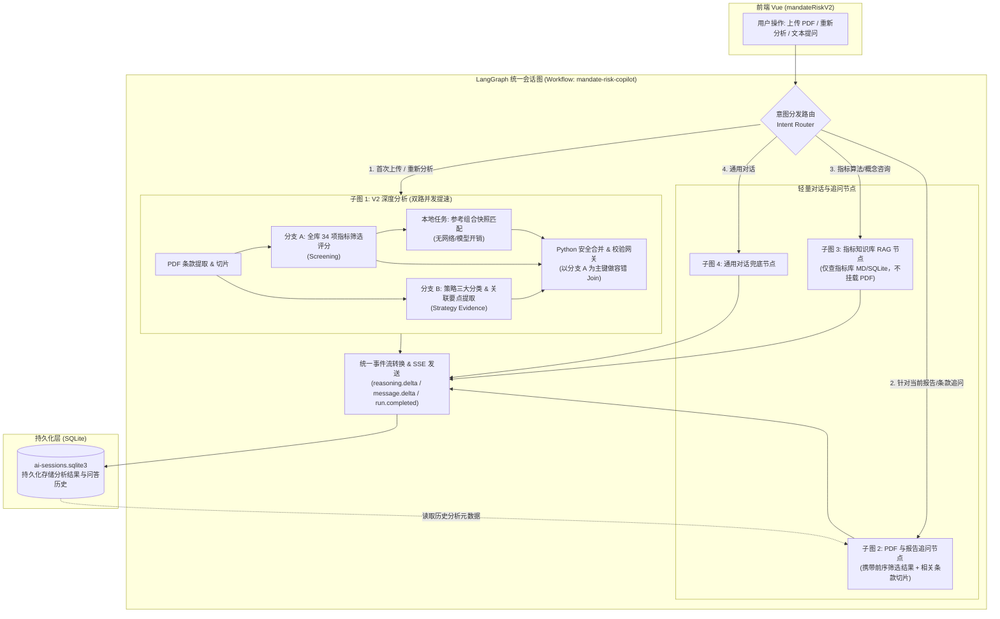

# 投资委托 PDF 风险分析 (V2) 性能提速与 LangGraph 统一多意图架构设计方案

> **文档状态**：方案审阅草案 (Design Proposal for Review)  
> **编写日期**：2026-10-14  
> **分支**：`research/mandate-risk-speed-2026-10-14`  
> **适用范围**：后端 `vmchat-hermes-replacement-python` 与 前端 `datadriver-fund-amc-tyjx-vue`

---

## 1. 现状背景与核心痛点

当前投资委托分析（Mandate Risk V2）流程在实际运行中存在两个核心痛点：

### 痛点 1：PDF 初次全面分析端到端耗时过长（约 60 秒以上）
通过对系统全链路的追踪，核心耗时集中于**两次串行的大模型（LLM）推理交互**：
1. **阶段 1：指标筛选（Screening）**：模型阅读 PDF 条款与 34 个库指标，给出匹配评分（DIRECT / REVIEW / NOT_RELEVANT）与依据条款 ID（耗时约 25~35 秒）。
2. **阶段 2：策略依据与指标关联（Strategy Evidence）**：等待阶段 1 完成后，将入选指标列表作为输入再次送入模型，提取 Instruments、Benchmark、Investment Strategy 三大原文分类并建立指标关联（耗时约 20~30 秒）。
3. **依赖关系**：阶段 2 强依赖阶段 1 的产出，导致两次网络往返与生成等待**只能严格串行**。

### 痛点 2：多模式对话割裂，“失忆”且缺乏统一编排
用户在前端的工作交互包含三种典型意图：
1. **PDF 深度全面分析**（核心功能，耗时长，生成完整指标表与依据）。
2. **针对已分析 PDF 的条款追问**（例如：“*为什么选了夏普比率？依据条款在第几页？*”）。
3. **针对指标库算法/定义的咨询**（例如：“*什么是跟踪误差？计算公式是什么？*”）。

**当前架构缺陷**：
- 前端充当了“肉身路由器”：上传分析时硬编码发往 `mandate-risk-analysis-v2`，普通提问时硬编码发往 `simple-chat`。
- 两个工作流上下文割裂：`simple-chat` 无法感知 V2 已经筛选出的指标结构与评分，只能再次拿着大篇幅 PDF 重新泛化回答，极易产生口径冲突；同时，仅问一个指标定义也会无脑带上全篇 PDF，既浪费 Token 又拉长响应时间（10s+ 变为常态）。

---

## 2. 目标架构与设计拓扑

通过将 V2 改造为**双路并发子图**，并引入 **LangGraph 统一意图路由器（Intent Router）**，收敛前后端通信协议。



---

## 3. 关键模块深入设计

### 3.1 核心提速方案：打破 V2 串行依赖，实现“双路并发”

#### 【设计机制】
- **分支 A（指标筛选模型调用）**：
  - 输入：`PDF 结构化条款 (clauses)` + `完整指标库 (34 项)`
  - 输出：34 项指标的 `level`（DIRECT/REVIEW/NOT_RELEVANT）、`match_score`、关联理由、条款依据 ID。
- **分支 B（策略提取模型调用）**：
  - 输入：`PDF 结构化条款 (clauses)` + `完整指标库摘要 (34 项基本信息)`
  - 输出：三大分类（Instruments、Benchmark、Investment Strategy）的条款归属，以及策略要点中潜在关联的指标 ID。
- **本地参考组合处理**：
  - 在分支 A 返回的第一时间，同步执行本地快照匹配（`ReferencePortfolioResolver.enrich_result`），耗时为毫秒级。
- **Python 合并网关（Safety Join）**：
  - 传统方案中，分支 B 必须等待分支 A 的选中结果。现在让两分支**同时并发启动**（通过 `asyncio.gather` 或 LangGraph 并行分支）。
  - 合并策略：**以分支 A（最终确立的入选指标）为主键**。
    - 若分支 B 提取的要点中包含分支 A 入选的指标，做证据融合。
    - **容错兜底机制**：若分支 B 遗漏了分支 A 选中的某个边缘指标，Python 兜底逻辑自动从分支 A 的原有依据补充生成基础关联，**严格禁止触发异常死锁重试**。

#### 【预期收益】
- 模型调用次数不变（依然是 2 次），但网络等待由 `T(A) + T(B)` 变为 `max(T(A), T(B)) + T(Join)`。
- 端到端分析耗时预计由 **60s 左右缩短至 35~40s**，提速约 **35%~45%**。

---

### 3.2 意图路由层（Intent Router）设计

为了防止引入意图识别大模型带来额外的 2~3 秒延迟，路由器采用**“确定性规则优先 + 轻量级启发式匹配”**策略（零网络开销）：

```text
用户请求进入 Router
│
├── [Rule 1: 首次上传或显式分析]
│   条件: 请求挂载了 document_id，且 (历史消息为空 OR 消息包含 "分析/重新分析/筛选/提取")
│   ===> 路由至: V2 深度分析子图 (V2Subgraph)
│
├── [Rule 2: 指标库知识提问]
│   条件: 命中 34 项指标名称/别名 且 包含 ("定义/怎么算/算法/计算公式/什么含义/口径")
│   ===> 路由至: 指标知识库 RAG 节点 (NODE_KB_QA)
│   效果: 不加载 PDF 正文，直接查指标库 MD，响应从 10s+ 降至 2~3s。
│
├── [Rule 3: 针对当前 PDF 依据追问]
│   条件: 会话中已存在 V2 分析结果，且问题包含 ("依据/为什么/第几页/条款/出处/解释")
│   ===> 路由至: PDF 追问节点 (NODE_DOC_QA)
│   效果: 上下文仅注入已筛选出的指标结构与对应章节条款，避免重复阅读全篇文档。
│
└── [Rule 4: 其他兜底]
    ===> 路由至: 通用对话节点 (NODE_CHAT)
```

---

### 3.3 LangGraph 状态机（State）设计与内存防臃肿机制

LangGraph 的 State 会在节点间流转并被 Checkpointer 序列化。若将几十页 PDF 全文装入 State，会导致显著的内存拷贝开销。

```python
from typing import TypedDict, Optional, List, Dict, Any, Literal

class UnifiedAgentState(TypedDict):
    # 基础会话标识
    session_id: str
    run_id: str
    user_message: str
    document_id: Optional[str]
    intent: Literal["full_analysis", "doc_qa", "metric_qa", "chat"]

    # 业务轻量结构体（只存结构化结果，不存动辄几十万字符的原文字符串）
    screened_metrics: Optional[List[Dict[str, Any]]]     # 分支 A 产物
    strategy_sections: Optional[List[Dict[str, Any]]]    # 分支 B 产物
    reference_portfolio: Optional[Dict[str, Any]]       # 参考组合配置
    
    # 问答与中间过程流
    reasoning_logs: List[str]
    output_markdown: str
    metadata: Optional[Dict[str, Any]]
    error: Optional[str]
```
- **原文隔离策略**：PDF 原文及切片条款存储在 `WorkflowContext.document_loader` 内存缓存中，节点按需惰性读取，**禁止写入全局 State**。

---

## 4. 技术风险与应对方案 (Risk Assessment & Mitigations)

| 潜在风险 | 风险影响 | 应对方案 |
|---|---|---|
| **分支 B 并发时遗漏分支 A 选中的指标** | 导致策略关联中某些指标丢失依据 | 在 Join 节点实现**确定性兜底补偿机制**：以分支 A 的入选列表为全集，缺席的指标自动继承分支 A 的 `evidence_clause_ids`，确保结构 100% 完整。 |
| **全库 34 项直接送入分支 B 是否会超长** | Token 暴增或注意力发散 | 当前指标库仅 34 项，精简为 `{id, name, type, algorithm_summary}` 后仅占约 3000 Token，完全在 Gemini 上下文窗口舒适区内。 |
| **LangGraph 节点流式输出与现有 SSE 协议冲突** | 前端无法收到实时推理进度条 | 继承现有 `WorkflowProtocol`，在 LangGraph 外部使用适配器监听节点的 `custom_event`，无缝转化为前端已有的 `reasoning.delta` 和 `message.delta`。 |
| **新流程对旧生产流程产生破坏性影响** | 线上已有功能回退 | 采用**影子工作流策略**：新图注册为独立工作流 ID `mandate-risk-copilot`，保留 `mandate-risk-analysis-v2` 和 `simple-chat` 原样不动。 |

---

## 5. 分阶段实施路线与里程碑 (Milestones)

### 阶段 1：V2 内部双路并发改造（核心提速验证）
- **目标**：在不引入 LangGraph 的情况下，先在纯异步层面打通“分支 A + 分支 B”并发并完成结果合并。
- **改动范围**：
  - `app/mandate_risk_v2/pipeline.py`
  - `app/mandate_risk_v2/strategy_evidence.py`
  - `app/workflow/graphs/mandate_risk_v2.py`
- **交付标准**：
  - 使用相同测试 PDF 对比单次分析端到端耗时，记录基准耗时（期望从 60s 降至 40s 左右）。
  - 验证入选指标数量、策略三大分类完整性与原单线流程一致。

### 阶段 2：LangGraph 子图封装与状态设计
- **目标**：将阶段 1 的双路并发封装为标准的 StateGraph 拓扑子图。
- **改动范围**：
  - 新建 `app/workflow/graphs/mandate_risk_v2_graph.py`
- **交付标准**：
  - 具备标准的 `compile()` 与 `ainvoke()` 接口。
  - 通过 SSE 适配器正常发出阶段进度通知。

### 阶段 3：多意图路由与追问/知识库节点合并
- **目标**：构建顶级 Router，实现 PDF 分析、追问、指标库问答的统一调度。
- **改动范围**：
  - 新建 `app/workflow/graphs/unified_agent.py`
  - 注册 `mandate-risk-copilot` 工作流至 `app/workflow/legacy.py`
- **交付标准**：
  - 提问“什么是跟踪误差”耗时 < 3 秒且不携带 PDF。
  - 追问“为什么选夏普比率”能精准结合前序 V2 结果作答。

### 阶段 4：前端适配与全链路联调
- **目标**：前端 `session.js` 统一接入新工作流，验证所有交互视图。
- **改动范围**：
  - 前端 `src/views/mandateRiskV2/session.js`、`api.js`
- **交付标准**：
  - PDF 连续滚动、高亮跳转、对话分栏左右拖拽全部正常。
  - 首次分析提速显著，后续追问上下文连贯。

---

## 6. 评审问题清单（供其他 AI 或架构师专项评估）

在将本方案交付其他 AI 或架构评审时，建议重点关注以下几个问题：
1. **并发 Join 的容错性**：在分支 A 与分支 B 并发运行的情况下，以分支 A 为主键做补偿合并的策略，是否足够健壮？是否还有其他数据一致性漏洞？
2. **状态轻量化设计**：将 PDF 条款切片与原始正文隔离在全局 State 之外，仅通过 `WorkflowContext` 按需获取，这种设计在 LangGraph 最佳实践中是否最优？
3. **路由规则的复杂度**：当前的零延迟规则匹配（Rule-based Router）是否足以覆盖 95% 以上的用户对话意图？是否有必要引入意图重写（Query Rewrite）机制？
