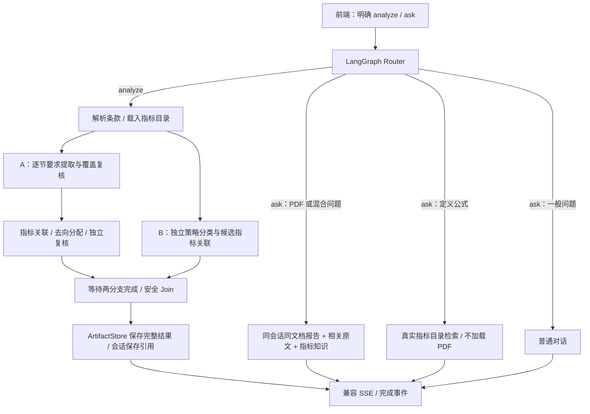

# Mandate Risk V2：并发分析与统一问答实施方案

- 状态：实施版；修订于 2026-10-15。
- 分支：前后端 `research/mandate-risk-speed-2026-10-14`。
- 原始评审输入：`pasted_file_N22HPv_mandate-risk-speed-and-langgraph-design.md`。
- 范围：Copilot 默认原文要求驱动的 detailed 分析、PDF/报告追问、指标知识问答、统一前端入口。独立 `mandate-risk-analysis-v2` 仍可显式使用原 screening 模式。

## 1. 决策与不变量

1. 新工作流 `mandate-risk-copilot` 使用 LangGraph 路由和并行子图；复用现有 Pipeline、指标目录、原文定位和报告格式，不复制整套 V2。
2. 前端通过 `context.operation=analyze|ask` 明确操作；“分析一下为什么没选某指标”不会触发重新分析。未上传 PDF 也可问指标知识。
3. A 分支先运行既有 RequirementExtractionPipeline 和覆盖复核，再运行 MappingPipeline 与独立 Critic；B 分支独立整理策略原文。Join 仅保留最终指标的 B 关联。禁止、配置、治理要求及指标库缺口不因无入选指标而省略。
4. B 没有建立关联的指标必须明确未关联，不能把 A 的筛选依据冒充策略关联。未知指标、伪造 clause_id、相互矛盾的处置继续拒绝。
5. 文档确实缺失某类原文时允许该分类为空；不强制补齐三类，不编造阈值或组合实际值。
6. PDF 正文不写图 State/checkpoint；本次运行通过 document_loader 按 ID 读取，节点共享只读局部上下文。LangGraph 不代替业务会话存储。
7. 全量结构化结果存入既有 ArtifactStore，会话保存引用。按 session/document/run 绑定，保存成功后才发送 completed；换文档不会读取旧报告。问答不能覆盖前端已有分析表格。
8. 沿用现有 SSE 与 `metadata.mandate_risk_v2.result`；保留 Docker AI API 地址，不改全局 OMP 或模型。

## 2. 数据流

## 3. 接口与模块

### 请求与响应

- `POST /v1/runs`：workflow=`mandate-risk-copilot`，context.operation=`analyze|ask`。
- analyze 必须提供一个 PDF；ask 的 documents 可为空。
- 分析输出保持 `metadata.mandate_risk_v2={phase,mode,result}`；问答增加独立 copilot 元数据标识意图，不冒充分析结果。
- 图内进度由适配层转换为 `reasoning.delta`，输出为 `message.delta`，结束仅产生一个 `run.completed` 或 `run.failed`。

### 并发分析

- `app/workflow/graphs/mandate_risk_v2_graph.py`：compiled StateGraph，A/B 各写独立 State 键，用显式多前驱边汇合。
- 复用 RequirementExtractionPipeline、MappingPipeline、build_v2_analysis_result 和 render_v2_report，不维护第二套要求数据模型。只有提取及覆盖复核完成后才能映射；原文小标题保存在 `requirement.attributes.source_heading` 并校验其确实出现在引用原文中。
- 策略提取公用验证与 canonical_evidence；新增独立目录入口，原旧接口保留其严格已选指标语义。
- Join 过滤未入选指标关联，保留真实分类与要点；缺席标记 unlinked，明确未完成独立策略关联，不自动升格 EXPLICIT。
- 分支异常/调用取消必须终止运行中的兄弟任务。记录真实调用用量和阶段耗时；长文档仍有窗口和已有校验修复，不能承诺始终两次请求。
- Copilot 已替代“只筛选指标”的入口：DIRECT 表示明示测量概念的直接关联，允许同义及需确认的参数差异；REVIEW 是有具体原文目标支持的待确认候选，不作为合同明示要求。一般长期增长、主动管理、库 Mandate 分类不能支持任意风险指标。每项原文要求保留直接关联、待确认、库内缺口或规则/非指标去向；历史结果不自动改写。

### 会话与问答

- `app/workflow/graphs/unified_agent.py`：图内路由 analyze、doc_qa、metric_qa、chat。
- `WorkflowContext` 增加请求操作上下文及绑定当前 session 的分析结果读取回调。
- main 在完成事件前保存 V2 结果 artifact；读取时同时检查 session/document，禁止只按全局最后一次结果查找。
- explicit analyze 优先；ask 中明确 PDF/报告语境优先于定义关键词。纯指标定义从规范目录检索，禁止自动附加 PDF；找不到知识时明确缺失。
- PDF 追问读取保存的原文要求、条件、各类去向、指标关联及相关 clauses，结合指标知识解释；未入选、未分析、缺失证据时如实说明，不能猜测未保存的模型判断。
- 复用现有消息历史，避免额外 checkpoint 数据库和两套状态事实源。

### 前端

- `api.js` 接收 operation、允许 ask 无 document；`session.js` 分析与对话统一 workflow 和 session。
- PDF 上传/换文档仍触发 analyze；普通输入触发 ask，内部默认提示词不展示。
- 问答只更新对话消息，不覆盖当前 metadata；换文档清理旧报告并取消旧任务。
- 保持 Excel 导出、入库、分栏拖拽、连续 PDF 滚动、原文跳转。

## 4. 性能与失败边界

- 理想模型等待从 A+B 变为 max(A,B)，实际效果受窗口、修复、模型排队和配额影响。
- 当前本地 OMP 代理每次创建独立 CLI 进程，源码未见串行模型锁；实际同时调用、取消后的进程回收需要验证。
- 不添加模型重试层，不隐藏校验异常。沿用原有错误协议；避免新增并发造成静默部分成功。
- 预期提速和知识问答 3 秒仅作为观察目标，不作为无条件 SLA。记录同 PDF 多轮耗时与真实模型输出，不拿不同文档的耗时作对比。

## 5. 实施与验收

1. 修订方案、确定合同；实现独立策略入口与安全 Join。
2. 实现 LangGraph 并行分析、统一意图图、结果持久化与注册。
3. 前端迁移；保持原有 API 部署配置及视图交互。
4. 行为测试覆盖：并发汇合、失败取消、真实证据/ID 校验、未关联、路由优先级、无 PDF 问答、session/document 隔离、重启读取和完成事件顺序。
5. 同一 PDF 多次运行旧/新工作流，记录阶段/总耗时、调用数和关键指标召回；模型非确定输出不要求每个分数完全相同。
6. 经真实 OMP 模型完成 PDF 分析、报告追问、纯指标知识问答；浏览器验证页面上传、结果、问答、导出和 PDF 证据交互。记录 URL、断言、console/network、截图/日志。
7. 验证后更新运维说明，移除临时脚本。默认不提交或推送代码；生产 Docker 不自动部署。
